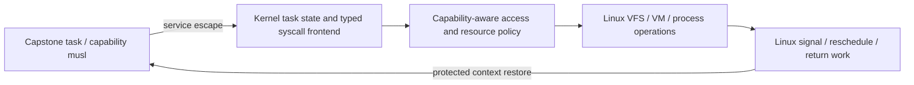

# Native Linux tasks for Capstone

Status: proposed implementation architecture on `native/linux-task-integration`.
No native task backend is implemented by this document. The measured runtime
remains the ioctl-backed prototype at `a13e2ffaa9a2`.

This refines the existing [native-task north star](../../plans/2026-11-03-boundary-north-star.md#3-the-end-state-three-independent-design-reviews-2026-11-03). It does not replace its page-reuse or revocation invariants.

## Decision

Make a Capstone program a first-class Linux task with a capability-aware user
ABI. Linux owns scheduling, signal selection, credentials, file identity,
virtual memory and process lifecycle. The architecture adapter owns the
protected capability execution state and its entry/return protocol. Existing
Linux operations implement services after a typed authority check.

Do not add a permanent `capstone_enter` syscall merely to wrap the current ioctl
loop. Do not make a vDSO function the security boundary. An explicit setup/control
interface may still be needed, but it is separate from normal execution and must
not own a running task's only context reference.

The `.dom` format handler is an exec loader. It must eventually install the
Capstone task state and initial PC/stack capabilities directly, instead of
installing a scalar U-mode trampoline and a control descriptor. The kernel's
architecture return path selects Capstone entry for that task. Domain escapes
rejoin Linux scheduling and return-to-user work; they do not require a user
process to reissue an ioctl.

## State and scheduling

A task owns its register/FP state, request continuation and signal-continuation
stack. Its mm owns the address-space lifetime namespace and mapping authority;
threads sharing an mm share that namespace, not independent copies of it.
Hardware slots are a per-CPU execution cache, never the owner of either lifetime.
Immutable captured request authority is separate from mutable resume/reply state;
a pending request must not silently acquire authority from a newer register frame.
Use explicit task/mm references through blocking operations, failed exec and
exit. A private file descriptor must not be required to keep the task alive.
Save/export buffers must be stable, nonpageable kernel storage addressable by the
transport. Evicting an idle task must not fault, sleep, or acquire a lock held by
that blocked task. This concerns kernel context storage, not payload-page pinning.

Reuse the privileged context transport/CSRUNV model initially. Preserve both
payload halves, tags, opaque raw state, supported bounds state, capability CSRs,
FP bits/FCSR, PC and namespace/translation identity. Never reconstruct authority
from a scalar cursor or an untrusted byte serialization. Validate ownership and
address-space identity on restore, including eviction and address-space reuse.

The architecture backend must obey Linux's pending-work and interrupt/preemption
ordering before each entry. After a quantum, interrupt, page fault or service
completion it processes rescheduling and signals before resuming. No global VM
lock or non-evictable hardware-slot reservation may span an arbitrary blocking
syscall. An idle resident slot may remain cached if another task can safely evict
it; eager export on every sleep is not required.
The final pre-entry check and state installation must close the race with newly
pending work. This is an architecture protocol, not a call to a long-running
module function from an arbitrary return-path location.

Linux must account domain computation as user execution, not simply kernel time
inside CSRUNV. A retained model quantum can be a bounded transition aid in the
first backend, but ordinary Linux timer/preemption handling is the end state.

Context tracking, RCU quiescent-state handling and IRQ/lockdep state must match
actual domain execution and escapes. The protected frame is the source of truth;
any scalar pt_regs view for audit/debugging must not become a source of tags or
silently describe the outer trampoline instead of the domain operation.

The current backend returns a protected event record from CSRUNV and resolves
faults through Linux VM helpers. It does not establish that an ordinary Linux
trap frame exists. Specify the timer/page-fault return PC, event publication,
interrupt state and retry behavior before selecting kernel hooks. Do not assume
that fabricating pt_regs and calling do_page_fault is required or sufficient.

Coordinate active and cached context state with Linux TLB invalidation, mapping
changes, sibling munmap and OOM/mm teardown. Choose the necessary MM/architecture
hooks and invalidation granularity from the actual transport and translation
contract; a mandatory notifier API or whole-slot invalidation is not established
by this design.

Single-hart qualification comes first. CPU migration, SMP and hotplug need
separate ownership, TLB and namespace-lifetime gates; none is implied by current
one-slot/two-task tests.

## Syscall ABI and Linux reuse

The existing explicit native-register stub is the starting transport: preserve
six argument capabilities, a scalar number/selector, and an authenticated escape
epoch. Ordinary scalar results clear tags. Mapping/authority-returning operations
need a separately typed result; a successful scalar mmap cursor is insufficient.
Version the ABI before integrating the SDK globally. Do not mix its number/selector
layout with the conventional RV64 Linux register convention by accident.

A scalar-only syscall can reuse Linux functionality after normal entry policy.
Domain syscalls need explicit integration with syscall audit, tracing, seccomp
and return-work hooks, against their real ABI and interrupted context. Do not
run policy once on an outer enter call and silently bypass it on inner services.
Define the observable argument layout and prevent debugger/context writes from
creating capability authority; scalar Linux ptrace semantics cannot be copied
unchanged onto tagged registers.
A pointer-bearing syscall needs capability-aware access retaining the original
argument's tag, rights, bounds, liveness, namespace and epoch through every copy,
fault, sleep and continuation. VM accessibility alone is not authorization.
The ordinary scalar `access_ok`/`copy_from_user` interface cannot recover this
provenance after converting a capability to an address.

For nested arguments such as iovec and msghdr, the frontend imports tagged pointer
fields and the ABI layout using checked snapshots or checked iterators. It does
not read a scalar address out of a user buffer and grant it ambient VMA authority.
Race handling must prevent a changed pointer graph or revoked object from
reusing a prior successful check. Preserve whole-operation VFS semantics:
looping kernel_write over iovecs is not equivalent to one vectored operation.

For the first backend, retaining the exchange ABI does not require retaining
the control FD. The current `.dom` loader already allocates the metadata and
exchange regions and grants their capabilities into startup registers before
creating the trampoline/control descriptor. Preserve that validated bootstrap
contract under task/mm ownership; the domain discovers those capabilities through
its existing startup ABI. Do not substitute scalar auxv addresses for authority.

Keep the existing checked-copy engine and kernel-buffer-safe Linux providers
for the first task backend. Retain their bounce buffers until a checked user
iterator/access path has independently passed the authority/race tests. Factoring
kernel-buffer-safe helpers is valid; passing kernel memory to a helper that still
expects `__user` pointers is not. A declarative syscall table reduces duplicated
layout work; it does not automatically specify every ioctl, asynchronous pointer
retention or shared-memory futex lifetime.

This separates two milestones: native task entry/return, and reducing marshalling
and copy overhead. Neither requires waiting for every syscall family, but each
unsupported family must return an explicit error, without launcher fallback or
fake success.

## Resources and confinement

Use Linux file objects, credentials and ultimately the task's descriptor table
with normal close/dup/exec lifetime semantics. Removing the duplicate broker must
not silently weaken the current resource policy. Keep control resources private
until they disappear, and specify inherited descriptors and exec transitions.

Ordinary Linux task identity does not grant arbitrary memory authority. Interfaces
such as /proc/self/mem, ptrace, process_vm_*, device mmap/ioctl and retained buffers
can bypass capability bounds if exposed without a policy. Audit these routes and
preserve the confinement contract while expanding syscall coverage. Do not claim
blanket ordinary-Linux compatibility by forwarding every number.

## Signals, restart and process lifecycle

Linux selects signals and applies masks/default actions. Capability handler,
restorer and alternate-stack registration must retain authenticated authority.
An interrupted continuation remains in kernel-controlled tagged state; a user
signal frame must not be a source for fabricating tags. Define permitted ucontext
edits, nested delivery, siglongjmp/setcontext abandonment and rt_sigreturn token
validation before finalizing the ABI. A copied or replayed continuation token
must not restore another task or an obsolete continuation epoch. Restoring
saved bits of a capability revoked by
a handler is legitimate, but must not restore its liveness: later access still
faults. Do not reject every continuation merely because it contains stale values.

Track service progress explicitly: captured, not committed, committed/partial,
reply published, and retired. Preserve Linux restart/partial-result semantics;
never retry committed I/O merely because a signal arrived. The prototype's
blanket ERESTART-to-EINTR normalization is not the final signal contract. A
restarted pointer access must still be authorized when it executes again.

Exec prepares replacement task/mm namespace state. Before Linux's point of no
return, failure preserves the old image; after that point, failure terminates
cleanly and reclaims new state rather than pretending to roll back exec.
CLONE_VM shares the mm namespace; masks and capability continuations are per
thread, while dispositions and group state follow CLONE_SIGHAND/CLONE_THREAD.
Fork/COW needs a specified child namespace and tagged-memory relationship so
parent revocation cannot incorrectly govern an independent child; copying scalar
registers or namespace pointers is not enough. Do not enable fork until the
namespace/tag transport model and failure behavior have a testable contract.
Ordinary Linux VMA permissions, COW and fault handling remain authoritative.
Final mm teardown stops/quiesces sibling execution and outstanding accesses,
invalidates the namespace, then releases its state and backing. Tag clearing
on physical-page reuse remains mandatory.

## Execution and request transitions

These are invariants for the first backend, not an implemented API:

| State / event | Required transition |
|---|---|
| Exec prepared | Publish runnable task state only after mm/namespace/frame validation; pre-commit failure unwinds unpublished ownership; post-point-of-no-return exec failure terminates cleanly. |
| Runnable, pending Linux work | Process reschedule/default signals/task work before attempting protected entry. |
| Running, quantum/interrupt | Save lossless task state, release execution-slot ownership as needed, and rejoin Linux return work. |
| Running, service escape | Capture immutable argument authority and a request identity; keep restart PC distinct from resume PC. |
| Service captured, not committed | Validate policy and checked inputs; cancellation/restart follows Linux semantics without creating side effects. |
| Service executing or blocked | Retain task/mm/request references, not a global execution lock or non-evictable hardware slot; every later memory access remains authority checked. |
| Service committed or partially committed | Preserve completion/progress exactly once, even if a signal arrives before result publication. |
| Reply pending | Publish the recorded result with the required tag policy once; process Linux return work before resuming the caller. |
| Signal handler / nested request | Preserve the interrupted request and continuation separately; handler requests cannot overwrite its authority snapshot. |
| Fatal exit / exec replacement | Prevent new entry, quiesce accesses, retire obsolete continuations and namespace ownership, then reclaim. |

A scheduling transition does not grant new authority. Execution epochs, request
identities and namespace generations have different purposes; the implementation
must define their transitions rather than treating all as one counter. The first
patch must instantiate this table against real Linux entry/exit and signal hooks.

## vDSO and expected performance

A capability-compatible vDSO can later serve eligible read-only queries such as
time from explicitly granted data. It runs without kernel privilege and cannot
replace VFS, mapping operations or the authority check for arbitrary services.
It is an optional optimization after the task ABI is stable.

Native integration removes the control-FD/trampoline dependency and creates a
correct place for signals, scheduling and restart. No speedup is claimed yet. Return-work/context tracking and wider state
spill/fill may initially increase some costs relative to the batched prototype.
The current ioctl loop already handles multiple domain services per invocation;
renaming its entry does not remove their copies or work. Wider application
objects also create more mapping work on pristine musl/Linux, independently of
this architecture. Keep entry costs and allocator costs separate in evaluation.

## Existing evidence and remaining decisions

- [Current native prototype and GCC measurements](../../../runtime/virtual/tests/native-integration/README.md).
- [Trusted context interface proposal](../../../runtime/include/capstone/native-context.h)
  and [hosted reference tests](../../../runtime/virtual/tests/native-context/README.md):
  useful contracts, not an implemented architecture-return backend.
- [Native register stub](../../../ports/musl-capstone/runtime/native-syscall.S).
- [Current module entry/loader](../../../runtime/virtual/module/binfmt-dom.h)
  and [step engine](../../../runtime/virtual/module/capstone_vm.c).
- [Implementation gates](../../plans/native-linux-task-integration.md).

Before the first kernel entry patch, settle the precise Linux 6.1 entry/return
hook and interrupt-state contract, the capability signal-frame/restart ABI,
namespace ownership hooks and which transport/ISA gaps require QEMU changes.
These are implementation decisions requiring code-level validation, not details
that model review alone can qualify. Linux-core and architecture changes are
necessary; a module-only ABI rename cannot deliver this design.

Architecture review: Astra (xhigh) and Gemini Argon both recommend this endpoint
and staged task-return milestone. Their review is design input, not execution or
security qualification. Exact Linux hooks, trap/frame adaptation and invalidation
APIs remain subject to implementation evidence as stated above.
